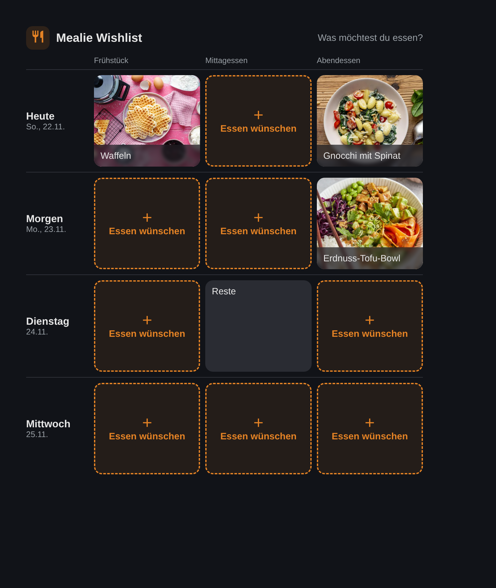
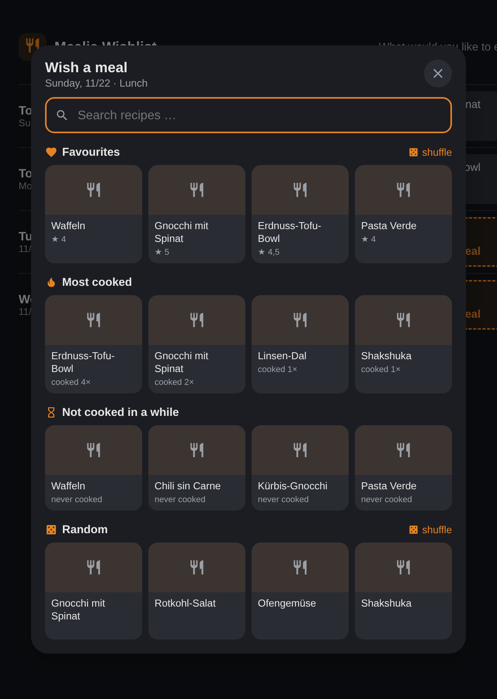
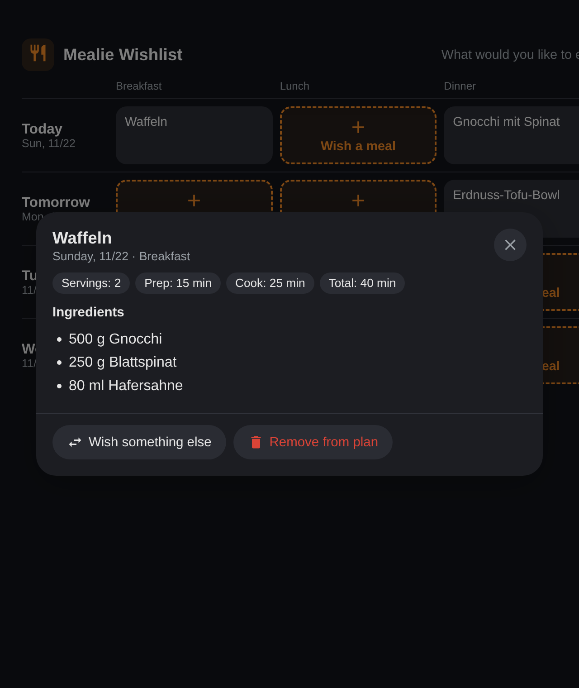

# Mealie Wishlist Card

A Home Assistant dashboard card for [Mealie](https://mealie.io). It shows your meal plan for the next days and puts a big **"Wish a meal"** button into every empty slot. Anyone in the household can tap it, pick a recipe and it lands in the Mealie meal plan – no sub-menus.

<p align="center">
  
</p>

## Features

- Meal plan for today and the next days – the number of days is configurable, the list simply continues downwards
- Any combination of meal types as columns (breakfast, lunch, dinner, side, dessert, snack, drink)
- Empty slot → one tap on **"Wish a meal"** opens the recipe picker
- Picker sections, configurable and in any order:
  - search with autocomplete
  - **pinned options**: recipes from chosen Mealie categories/tags or by name, plus options without a recipe (e.g. "Leftovers", "Cook from the pantry") that are added as meal plan notes
  - favourites (recipes with a rating at or above a threshold, shuffled)
  - most cooked (counted from your meal plan history)
  - not cooked in a while (meal plan history and Mealie's "last made")
  - random recipes
- Search without a result: add the typed name as a meal (meal plan note without recipe) or jump to *Create recipe* in Mealie
- Tap a recipe and it is wished – an optional confirmation can be switched on
- Tap on a planned recipe: details (image, description; times, servings and ingredients behind a *Details* toggle) with *Open in Mealie*, *Swap meal* and *Remove from plan* – each action can be disabled, or the tap can open Mealie / the picker directly / do nothing
- Header (title, subtitle, icon) freely configurable, each part can be hidden
- German and English, follows the Home Assistant language
- Visual editor
- Uses only the official Home Assistant Mealie integration – no Mealie token in your dashboard

<p align="center">
  
  
</p>

## Requirements

- Home Assistant 2025.1 or newer with the [Mealie integration](https://www.home-assistant.io/integrations/mealie/) set up
- Mealie 3.2 or newer (requirement of the integration)

## Installation

### HACS (custom repository)

1. HACS → ⋮ → **Custom repositories**
2. Repository: `https://github.com/andrelung/mealie-wishlist-card`, type **Dashboard**
3. Search for **Mealie Wishlist** and download it. HACS registers the dashboard resource for you.
4. Reload your browser.

### Manual

Copy `dist/mealie-wishlist-card.js` to `config/www/` and add `/local/mealie-wishlist-card.js` as a *JavaScript module* under Settings → Dashboards → ⋮ → Resources.

## Configuration

Add the card via the dashboard editor ("Mealie Wishlist") or in YAML:

```yaml
type: custom:mealie-wishlist-card
config_entry_id: 01ABCDEF...          # your Mealie integration (picked in the visual editor)
title: Mealie Wishlist
subtitle: What would you like to eat?
days: 7
meals: [breakfast, lunch, dinner]
wish_label: Wish a meal
picker: [search, favorites_random, most_cooked, not_cooked_lately, random]
url: https://mealie.example.com        # for images and "Open in Mealie"
```

| Option | Default | Description |
|---|---|---|
| `config_entry_id` | – | **Required.** Mealie integration entry |
| `show_header` | `true` | Show the header row |
| `title` / `subtitle` | translated | Header texts; `""` hides one |
| `icon` | `mdi:silverware-fork-knife` | Header icon; `""` hides it |
| `days` | `3` | Number of days starting today (1–31) |
| `meals` | `[dinner]` | Meal types shown as columns |
| `wish_label` | translated | Text of the wish button |
| `picker` | all | Picker sections and their order: `search`, `pinned`, `favorites_random`, `most_cooked`, `not_cooked_lately`, `random` |
| `picker_items` | `4` | Recipes per section (not for search and pinned) |
| `pinned_title` | translated | Heading of the pinned section |
| `pinned_categories` | `[]` | Mealie categories (name or slug) whose recipes are always pinned |
| `pinned_tags` | `[]` | Mealie tags (name or slug) whose recipes are always pinned |
| `pinned_recipes` | `[]` | Single recipes (name or slug) that are always pinned |
| `pinned_notes` | `[]` | Pinned options without a recipe; added as meal plan notes |
| `pinned_exclude_elsewhere` | `true` | Hide pinned recipes from the other sections |
| `history_days` | `180` | Days of meal plan history used for the statistics |
| `favorites_min_rating` | `4` | A recipe counts as favourite from this rating |
| `confirm_wish` | `false` | Ask before saving a wish |
| `recipe_tap_action` | `details` | Tap on a planned recipe: `details`, `mealie`, `change`, `none` |
| `allow_open_mealie` | `true` | Show *Open in Mealie* in the details (needs `url`) |
| `allow_change` | `true` | Allow swapping a planned recipe |
| `allow_remove` | `true` | Allow removing a planned recipe |
| `show_images` | `true` | Show recipe images (needs `url`) |
| `url` | – | Mealie URL, reachable from the device showing the dashboard |
| `mealie_group_slug` | `home` | Group part of recipe links |
| `language` | HA language | `de` or `en` |
| `max_width` | – | Optional maximum width of the **whole card**, e.g. `900px` (the card is centred) |
| `tile_min_height` | `64` | Minimum height of **each slot** (recipe tile or wish button) in px |
| `allow_free_text` | `true` | Search without result: offer to add the typed name as a meal |
| `allow_create_recipe` | `true` | Search without result: offer the link to Mealie's *Create recipe* form (needs `url`) |

Theme variables: `--mealie-wishlist-accent` (defaults to `--primary-color`), `--mealie-wishlist-text-backdrop` (opacity of the text strip over recipe images, default `70%`), `--mealie-wishlist-max-width` (defaults to a width that fits the number of meal columns; the card is centred). In a narrow column the meals wrap below each day with a small label.

**Width:** the card fills the space it gets. In a *sections* view set it in the card's *Layout* tab (grid columns) and widen the section if needed; alternatively use `max_width` or a *panel* view.

## Notes

- "Most cooked" counts **planned** meals – Mealie does not know what was actually cooked.
- Home Assistant's `mealie.get_recipes` returns at most 100 recipes; with more recipes the search additionally asks Mealie, the other sections use the first 100.
- The Home Assistant integration cannot create recipes. "Add as a meal" therefore creates a meal plan *note* with that name; the *Create recipe* link opens Mealie's own form (needs `url`).
- Favourites are based on the recipe rating, because the Home Assistant integration does not expose Mealie's per-user favourites.

## License

MIT
